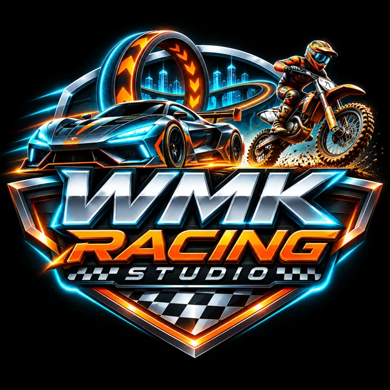

# WMK Racing Studio 3D — v0.5.1

Jogo de corrida experimental em HTML, CSS, JavaScript e Three.js. 24 pistas editáveis e 13 veículos procedurais, incluindo kart, Monster Truck, Cyber GT e Pulse AG (visual sem rodas).

## Executar
Extraia e abra index.html pelo Live Server do VS Code (obrigatório usar HTTP, pois os arquivos JSON são carregados com fetch). Internet necessária para as bibliotecas CDN. W/S aceleração e freio/ré; A/D direção; espaço freio de mão; V câmera; R retorno. Menu superior: escolha pista, Abrir, Editor, Painéis. Arraste os títulos dos painéis e use × para fechar. Restaurar limpa posições salvas.

## Pistas e veículos
Importe/exporte JSON pelo editor e garagem. Os arquivos em tracks/ e vehicles/ são carregados diretamente na inicialização por js/boot.js. Para duplicar uma pista, altere o nome no editor e exporte um novo arquivo. O arquivo original não é alterado.

## Documentação
- [Pesquisa](docs/pesquisa.html)
- [Roadmap](docs/roadmap.html)
- [Física extrema](docs/fisica-extrema.html)

## Limitações
Física arcade cinemática. Hover apenas visual; loopings, banking real e itens ainda planejados. Validação de sintaxe JS realizada; teste gráfico e de pilotagem pendentes.

Autor: **Walney Moreira Klein — walneyk@hotmail.com**. Licença MIT.

## v0.4.0
Painéis separados, minimapa, seleção de pistas no editor e no jogo, cópia e armazenamento local. Para curvas suaves: Compact GT, sensibilidade 55%, tempo de resposta 0,45 s, resposta do volante baixa. Física simcade experimental; teste gráfico pendente.

## v0.5.0
Três motos com pilotos, quatro circuitos novos, corrida com contagem regressiva, 0–7 bots, 1–20 voltas, classificação e pontuação de saltos. IA cinemática sem colisão entre rivais. Teste gráfico pendente. [Manual técnico de corridas e saltos](docs/corridas-e-saltos.html).

## v0.5.1 — Organização e identidade visual
HTML, CSS e JavaScript separados. Eventos da interface em `js/ui.js`; identidade visual no menu e nos manuais. Os 24 circuitos, 13 veículos e os recursos da versão anterior foram preservados.

[Arte de capa do Facebook](assets/logo/facebook.webp).

O carregador lê os 37 presets JSON diretamente do disco via HTTP, sem duplicar a configuração dentro de `game.js`.

## v0.6.0 experimental — Extreme Racing
[Entrar no modo extremo](extreme/index.html) · [Manual técnico](docs/extreme-racing.html). Três pistas paramétricas, três veículos, looping de 360°, banking, pista côncava, turbo e corrida com bots. Física cinemática magnética separada do jogo clássico. Teste gráfico pendente.
